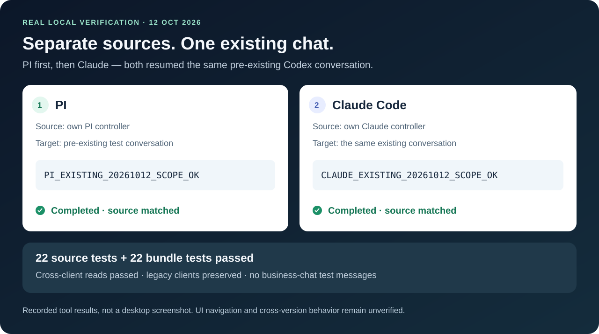

  
  
  
  

<b>让 Claude Code 和 PI，接上你正在使用的 Codex 桌面会话。</b> 
查找项目与聊天，读取上下文，继续原来的任务；回复仍出现在原来的 Codex 桌面会话里。

<a href="README.md">English</a> · <a href="https://github.com/autumnseasonism/codex-desklink/releases/latest">下载 Windows 安装包</a> · <a href="docs/INSTALL.md">安装说明</a> · <a href="docs/COMPATIBILITY.md">验证范围</a>

**0.2.1 更新：**Claude / PI 各有独立来源入口，可以控制任意已有本机索引主会话，支持真实新建项目，所有支持的功能明确开启；旧连接继续保留。[独立入口说明](docs/CLIENT_OWNED.md)。[下载 0.2.1](https://github.com/autumnseasonism/codex-desklink/releases/tag/v0.2.1)。

## 从上次停下的地方，继续工作

你先在 Codex 桌面讨论了一个任务，随后想让 Claude 或 PI 了解进展、请 Codex 继续处理。DeskLink 把这条连接打通，保留原来的聊天入口和桌面显示。

**MCP** 是让 Agent 使用外部工具的通用连接方式。DeskLink 提供八个工具，通过本机连接与正在运行的 Codex 桌面通信。

| 你想做什么 | DeskLink 提供什么 |
| :-- | :-- |
| 找到以前的任务 | 查看本机保存的项目，分页查找已索引会话，包括归档会话 |
| 了解之前的讨论 | 读取选中的会话；默认不返回工具执行输出 |
| 接续空闲任务 | 向原来的 Codex 会话发送新消息 |
| 恢复归档任务 | 经明确授权恢复归档，再继续发送 |
| 查看进展与结果 | 读取最新回合的进展、回复与完成状态；桌面原会话同步显示 |
| 新开一个任务 | 从客户端独立来源入口创建工作会话 |
| 新建一个项目 | 把已授权的现有文件夹注册为真实本机 Codex 项目 |

> **社区项目，实验性集成。** 底层依赖 Codex 桌面的内部接口，它可能随版本变化；当前验证平台为 Windows x64。用于重要工作前，请阅读[兼容性说明](docs/COMPATIBILITY.md)。本项目与 OpenAI、Anthropic、PI 无官方隶属或背书关系。

## 本机连接，结果可见

DeskLink 本身不开放网络监听端口。Codex 和客户端仍使用各自的模型服务；客户端读到的会话内容会进入该客户端的上下文，按它的数据处理规则使用。

### 真实本机验证

*上图是实际工具验收记录的清晰可视化，不是桌面截图。* 先 PI、后 Claude Code，两边均成功读取另一客户端创建的测试聊天，并接续同一个已有聊天；最终回复和完成状态已读回，原始消息来源分别指向各自控制入口。[验证范围与待验证项](docs/COMPATIBILITY.md)。

查看原始桌面截图（0.1.2 历史验收，点击图片查看原始尺寸）

原图只有 725 × 915，保留作为历史实机证据；不把它当作 0.2.1 来源链接点击或新项目侧栏显示的验收。

## 开始使用

**推荐下载 0.2.1 Windows 自包含包，并使用独立来源入口。** 包内带有工具、依赖和运行环境，无需另装 Node；Codex 桌面和客户端需自行安装、登录。

1. [下载 Windows ZIP](https://github.com/autumnseasonism/codex-desklink/releases/latest)，按 `SHA256SUMS.txt` 核验，再解压到长期保留的目录。
2. 请 Codex 桌面 Agent 核验当前聊天 ID、桌面连接、运行服务和允许使用的项目目录，然后初始化[独立客户端配置](docs/CLIENT_OWNED.md)。此模式明确开启全部支持功能，包括接续已有本机主会话。
3. 用 `start-pi-owned.ps1` 或 `start-claude-owned.ps1` 启动客户端。先检查连接、创建自己的控制聊天；之后沿用该聊天作为消息来源。
4. 选择已有本机主会话，或新建工作会话/项目。先读取目标状态，再按你的要求发送接续消息；回复仍显示在原目标聊天中。

给 **Codex 桌面 Agent** 的初始化示例：

> 请为我提供的 Codex DeskLink 文件夹建立 PI 和 Claude 独立入口。先核验当前聊天真实 ID、桌面 pipe、运行服务的可执行文件/control socket，以及允许注册项目的目录，再使用 setup-owned-clients.mjs。全部支持功能显式开启。保留已有配置和控制状态，不中断运行中的 Agent，不修改全局 hooks 或凭据；不要猜测连接参数。

给 **Claude Code 或 PI** 的接续示例：

> 用 Codex DeskLink 检查连接，尚无专用来源入口时先创建。找到我指定的已有聊天，读取上下文和状态，再发送我的后续要求；来源使用你自己的控制聊天。归档只有我明确要求时才恢复。报告回复及完成状态，发送不确定时不要重发。

已在使用的旧入口可继续沿用[旧版只读绑定流程](docs/INSTALL.md)。不要覆盖运行中的注册，下一次启动使用新入口；Codex 重启后可能需要重新核验连接。

## 权限与行为有明确边界

- **来源归属与目标范围分开。** 独立配置已开启全本机目标；旧版只读绑定默认限定范围。范围是已索引的本机主会话，不包括云端、ChatGPT、内部子 Agent 和已删除或未索引记录。
- **发送与新建单独控制。** 能看见项目，不等于可以在里面创建任务。独立配置均已开启；旧版绑定助手保持新建关闭。
- **归档恢复需要明确选择。** 继续归档会话需提供 `restoreArchived: true`。
- **发送记录持久保存。** 相同已接受请求不会重复发送；结果不确定时不自动重试。迁移已使用的安装目录时，独立入口保留 `profiles/state/`，旧入口保留 `state/`。
- **历史内容不是新授权。** 不应把旧会话里的指令当作本次操作许可。
- **最新回复不等于逐请求追踪。** 多个发送者可能改变最新回合；接收成功不代表任务完成。没有停止任务的工具。

**不需要 hooks。** DeskLink 不修改 Codex 全局钩子；已有钩子失败仍需单独排查。

## 八个工具

| 工具 | 用途 |
| :-- | :-- |
| `bridge_status` | 核验桌面连接，报告开启的权限 |
| `list_projects` | 查看已授权项目，或主动开启后的本机项目目录 |
| `list_conversations` | 按项目、归档状态筛选并分页查找会话 |
| `read_conversation` | 读取指定会话的一页内容 |
| `continue_conversation` | 发送明确授权的后续消息，可选择恢复归档 |
| `get_conversation_result` | 查看最新回合的进展、回复和完成状态 |
| `create_conversation` | 在单独开启的新建范围内创建本机聊天 |
| `create_project` | 先建立所属会话，再在允许目录内注册真实本机项目 |

客户端注册名保留 **`codex_desktop`**，兼容已有安装。项目及服务名称为 **Codex DeskLink / `codex-desklink`**。

## 参与项目

欢迎提供可复现的兼容性反馈、安装体验改进和范围明确的修复。请先阅读 [CONTRIBUTING.md](CONTRIBUTING.md) 和 [SECURITY.md](SECURITY.md)，不要在公开 Issue 中上传真实连接配置、原始聊天或凭据。

采用 [MIT 许可证](LICENSE)。运行环境和依赖保留各自许可，见 [THIRD_PARTY_NOTICES.md](THIRD_PARTY_NOTICES.md)。

## 技术细节（可跳过）

源码开发需要 Node 24+ 和 npm；Windows 安装包需在 Windows x64 构建。在源码目录执行 `npm ci` 安装锁定依赖，`npm test` 运行测试，`npm run build` 生成独立包。它输出到 `dist/` 下的新目录，包含匹配的 Node 许可，拒绝覆盖已有输出。普通使用者下载 Release 即可。
