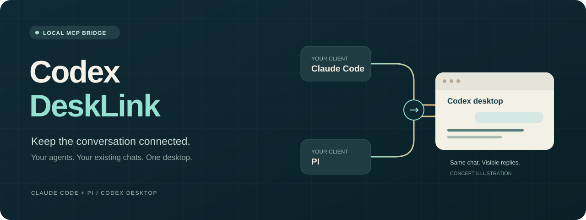
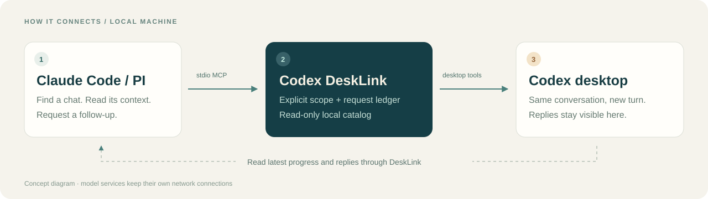
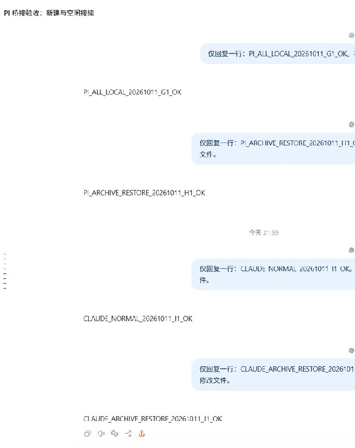

  
  
  
  

<b>让 Claude Code 和 PI，接上你正在使用的 Codex 桌面会话。</b> 
查找项目与聊天，读取上下文，继续原来的任务；回复仍出现在原来的 Codex 桌面会话里。

<a href="README.md">English</a> · <a href="https://github.com/autumnseasonism/codex-desklink/releases/latest">下载 Windows 安装包</a> · <a href="docs/INSTALL.md">安装说明</a> · <a href="docs/COMPATIBILITY.md">验证范围</a>

## 从上次停下的地方，继续工作

你先在 Codex 桌面讨论了一个任务，随后想让 Claude 或 PI 了解进展、请 Codex 继续处理。DeskLink 把这条连接打通，保留原来的聊天入口和桌面显示。

**MCP** 是让 Agent 使用外部工具的通用连接方式。DeskLink 提供七个工具，通过本机连接与正在运行的 Codex 桌面通信。

| 你想做什么 | DeskLink 提供什么 |
| :-- | :-- |
| 找到以前的任务 | 查看本机保存的项目，分页查找已索引会话，包括归档会话 |
| 了解之前的讨论 | 读取选中的会话；默认不返回工具执行输出 |
| 接续空闲任务 | 向原来的 Codex 会话发送新消息 |
| 恢复归档任务 | 经明确授权恢复归档，再继续发送 |
| 查看进展与结果 | 读取最新回合的进展、回复与完成状态；桌面原会话同步显示 |
| 新开一个任务 | 在单独开启新建权限后创建本机会话 |

> **社区项目，实验性集成。** 底层依赖 Codex 桌面的内部接口，它可能随版本变化；当前验证平台为 Windows x64。用于重要工作前，请阅读[兼容性说明](docs/COMPATIBILITY.md)。本项目与 OpenAI、Anthropic、PI 无官方隶属或背书关系。

## 本机连接，结果可见

DeskLink 本身不开放网络监听端口。Codex 和客户端仍使用各自的模型服务；客户端读到的会话内容会进入该客户端的上下文，按它的数据处理规则使用。

### 真实桌面验证

*实际测试截图，并非界面示意图。* PI 和 Claude Code 发来的接续消息，在同一条 Codex 桌面测试会话中收到了回复，包括恢复归档后的回复。截图仅保留测试会话区域。[验证记录](docs/COMPATIBILITY.md)区分了已验证能力和待验证场景。

## 开始使用

**推荐下载 Windows 自包含包。** 包内带有 MCP、依赖和运行环境，无需另装 Node。Codex 桌面与所选客户端需自行安装、登录。

1. [下载 Windows ZIP](https://github.com/autumnseasonism/codex-desklink/releases/latest)，按 `SHA256SUMS.txt` 核对文件，再解压到长期保留的目录。
2. 在 Codex 桌面打开一条聊天，让它核验真实连接并绑定这个目录。建议先只读；需要外部 Agent 发消息时再开启发送权限。
3. 运行包内的 Claude 或 PI 安装脚本。也可以先用临时启动脚本体验，再决定是否注册为日常工具。
4. 请客户端检查连接、列出项目和会话，读取选定的聊天；随后明确指示它继续这条会话。

给 **Codex 桌面 Agent** 的绑定示例：

> 请绑定我提供的 Codex DeskLink 文件夹。先核验当前会话 ID 和实际 CODEX_APP_TOOLS_PIPE_PATH，再运行 configure.ps1。允许查看本机所有已索引主会话，包括归档；先保持发送和新建关闭。不要猜测管道，不修改全局 hooks 或凭据。

开启发送后，给 **Claude Code 或 PI** 的使用示例：

> 用 Codex DeskLink 找到我指定的本机 Codex 会话，先读取最近上下文，再发送我提供的后续消息。如果已归档，只有我明确允许时才恢复。返回最新回复及该回合是否已完成；发送结果不确定时不要自动重发。

[安装说明](docs/INSTALL.md)提供各脚本入口、源码使用方法和权限选项。Codex 重启后可能需要重新绑定。

## 权限与行为有明确边界

- **读取默认限定范围。** 查看全部本机会话需要主动开启；范围是已索引的本机主会话，不包括云端、ChatGPT、内部子 Agent 和已删除或未索引记录。
- **发送与新建单独控制。** 能看见项目，不等于可以在里面创建任务。绑定助手始终保持新建关闭。
- **归档恢复需要明确选择。** 继续归档会话需提供 `restoreArchived: true`。
- **发送记录持久保存。** 相同已接受请求不会重复发送；结果不确定时不自动重试。迁移已使用的安装目录时，保留 `state/`。
- **历史内容不是新授权。** 不应把旧会话里的指令当作本次操作许可。
- **最新回复不等于逐请求追踪。** 多个发送者可能改变最新回合；接收成功不代表任务完成。没有停止任务的工具。

**不需要 hooks。** DeskLink 不修改 Codex 全局钩子；已有钩子失败仍需单独排查。

## 七个工具

| 工具 | 用途 |
| :-- | :-- |
| `bridge_status` | 核验桌面连接，报告开启的权限 |
| `list_projects` | 查看已授权项目，或主动开启后的本机项目目录 |
| `list_conversations` | 按项目、归档状态筛选并分页查找会话 |
| `read_conversation` | 读取指定会话的一页内容 |
| `continue_conversation` | 发送明确授权的后续消息，可选择恢复归档 |
| `get_conversation_result` | 查看最新回合的进展、回复和完成状态 |
| `create_conversation` | 在单独开启的新建范围内创建本机聊天 |

客户端注册名保留 **`codex_desktop`**，兼容已有安装。项目及服务名称为 **Codex DeskLink / `codex-desklink`**。

## 参与项目

欢迎提供可复现的兼容性反馈、安装体验改进和范围明确的修复。请先阅读 [CONTRIBUTING.md](CONTRIBUTING.md) 和 [SECURITY.md](SECURITY.md)，不要在公开 Issue 中上传真实连接配置、原始聊天或凭据。

采用 [MIT 许可证](LICENSE)。运行环境和依赖保留各自许可，见 [THIRD_PARTY_NOTICES.md](THIRD_PARTY_NOTICES.md)。

## 技术细节（可跳过）

源码开发需要 Node 24+ 和 npm；Windows 安装包需在 Windows x64 构建。在源码目录执行 `npm ci` 安装锁定依赖，`npm test` 运行测试，`npm run build` 生成独立包。它输出到 `dist/` 下的新目录，包含匹配的 Node 许可，拒绝覆盖已有输出。普通使用者下载 Release 即可。
